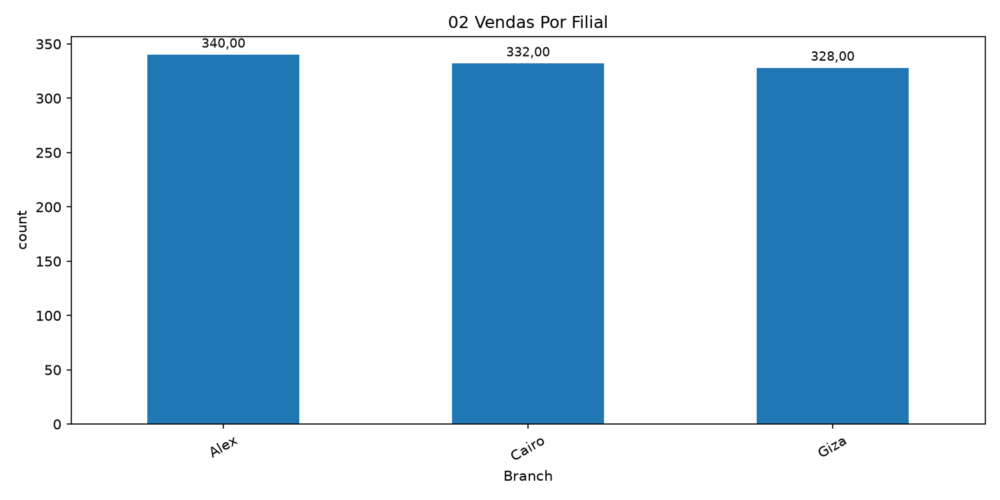
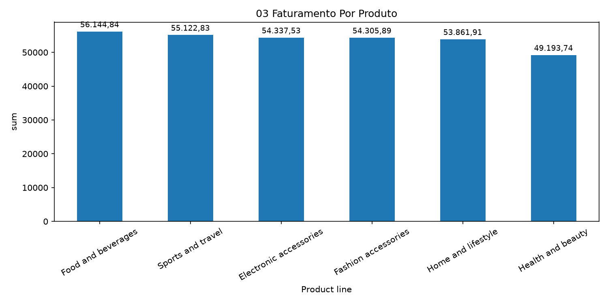
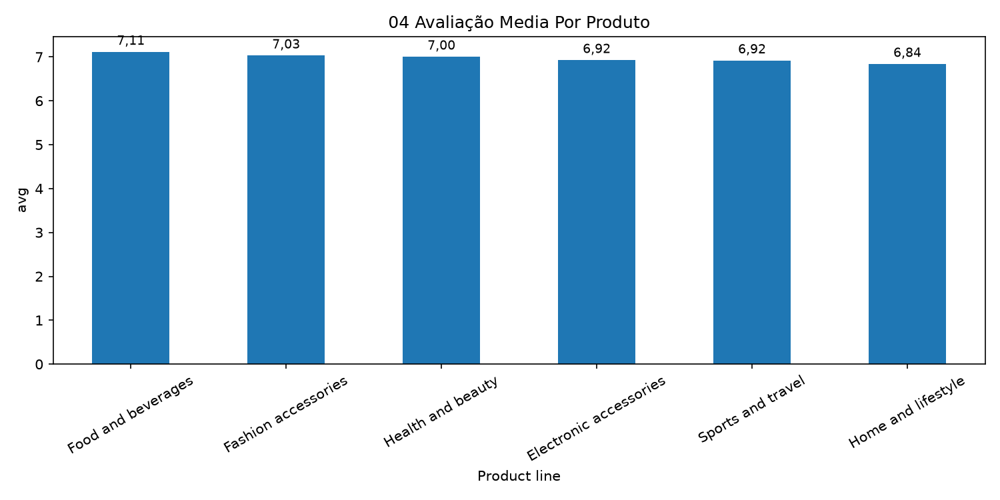
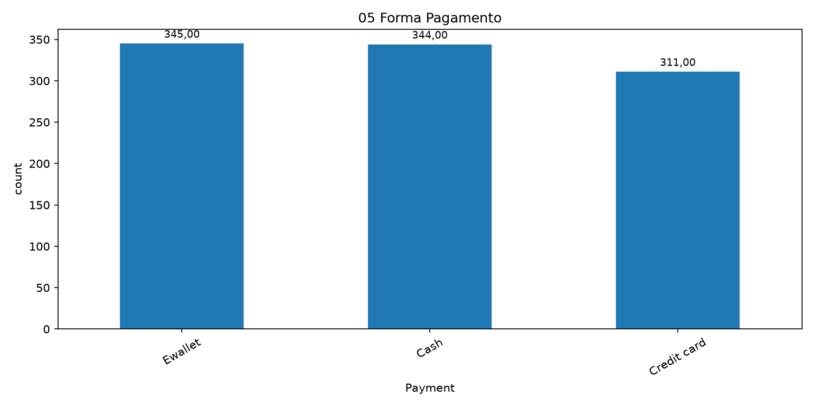
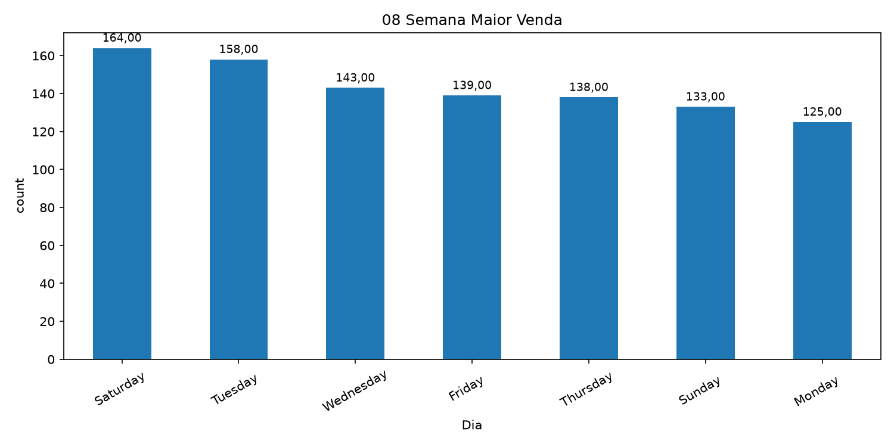

# Ambiente virtual Python

Na raiz do projeto, crie o ambiente virtual uma vez (se a pasta `.venv` ainda
não existir):

```sh
python -m venv .venv
```

Ative o ambiente antes de trabalhar no projeto. Use o comando correspondente ao
seu terminal:

```powershell
# Windows PowerShell
.\.venv\Scripts\Activate.ps1
```

```bat
:: Windows Prompt de Comando (cmd)
.venv\Scripts\activate.bat
```

Com o ambiente ativado, instale as dependências do projeto:

```sh
python -m pip install -r requirements.txt
```

Para sair do ambiente virtual, execute `deactivate`.

# PostgreSQL local

O banco de dados local roda em PostgreSQL 18 usando Docker Compose.

Para iniciar o banco na raiz do projeto:

```sh
docker compose up -d
```

Conexão:

- Host: `localhost`
- Porta: `5432`
- Usuário: `root`
- Senha: `admin123`
- Banco: `loja`

Para parar o contêiner sem apagar os dados:

```sh
docker compose down
```

Os dados ficam no volume `postgres_loja_data` e são preservados ao parar ou
remover o contêiner. As credenciais deste arquivo são adequadas apenas para
desenvolvimento local.

# Análise

Perguntas de negócio a serem respondidas:

## Qual filial apresentou o maior faturamento?


## Qual filial realizou a maior quantidade de vendas?



## Qual linha de produto apresentou o maior faturamento?



## Qual linha de produto recebeu a melhor avaliação média?



## Qual foi a forma de pagamento mais utilizada?



## Qual foi o valor médio das vendas?


## Qual foi a maior venda registrada?


## Em qual dia da semana ocorreu a maior quantidade de vendas?

